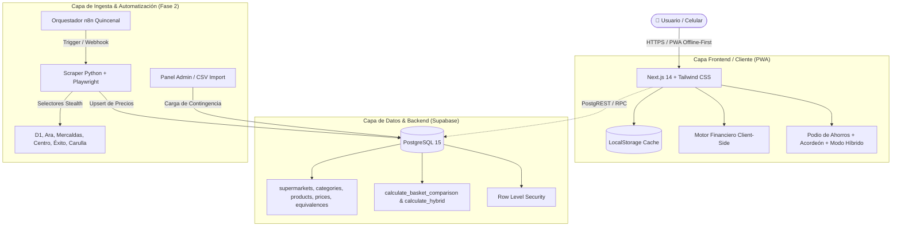

# 🏛️ Arquitectura del Sistema — Yo Merco (Colombia)

Plataforma inteligente de optimización de presupuesto familiar y comparador multicanal de retail para el mercado colombiano, con despliegue inicial en **Manizales (Caldas)** y escalabilidad nacional.

---

## 1. Diagrama de Arquitectura de Alto Nivel

---

## 2. Supermercados Integrados en el Ecosistema

| Supermercado | Tipo / Segmento | Ventaja Competitiva Evaluada |
| :--- | :--- | :--- |
| **Tiendas D1** | Hard Discount | Líder en abarrotes, marcas propias de alta economía. |
| **Tiendas Ara** | Hard Discount | Despensa y frescura con alta rotación de ofertas. |
| **Mercaldas** | Regional (Caldas) | Tradición manizaleña, rey en carnes y frutas locales. |
| **Supermercado del Centro** | Tradicional Urbano | Economía de plaza y víveres a granel. |
| **Éxito** | Hipermercado | Gran surtido, marcas propias y cobertura nacional. |
| **Carulla** | Premium / Delicatessen | Gama alta, productos gourmet y servicio especializado. |

---

## 3. Variantes de Valor Agregado e Innovaciones Implementadas

### A. Motor de Normalización de Equivalencias (Product Matching)
- **Problema:** En Colombia, D1 vende marca *Latti* o *De La Cuesta*, Ara vende *Sabrosón*, mientras Éxito y Carulla venden *Roa* o *Alquería*. Una comparación por nombre textual estricto falla.
- **Solución Implementada:** Tabla `product_equivalences` con factor de confianza (`match_confidence`) y modal interactivo para visualizar cómo se mapea la marca blanca frente a la marca líder.

### B. Modo PWA Offline-First
- **Problema:** La señal de datos móviles en los sótanos o pasillos de supermercados en Colombia suele ser deficiente o nula.
- **Solución Implementada:** La canasta, el presupuesto y los cálculos operan 100% en el cliente mediante `localStorage` y un motor financiero en TypeScript que no bloquea la navegación si no hay internet.

### C. Modo "Supermercado Híbrido" con Costo de Transporte Real
- **Problema:** Sugerir ir a 3 tiendas diferentes puede ahorrar $15.000 COP en productos, pero si el usuario gasta $17.000 COP en taxis o domicilios, tiene una pérdida neta.
- **Solución Implementada:** El algoritmo calcula el **Ahorro Neto Real**:
  $$\text{Ahorro Neto} = \text{Ahorro Bruto} - (\text{N° de tiendas adicionales} \times \text{Costo de transporte en Manizales})$$
  Si el ahorro neto es negativo, la plataforma advierte con badge amarillo que es preferible comprar todo en una sola tienda.

---

## 4. Estructura de Base de Datos (PostgreSQL en Supabase)

- **`supermarkets`**: Información institucional y tier de las 6 cadenas.
- **`categories`**: Categorías de la canasta familiar.
- **`products`**: Catálogo maestro de 50 productos normalizados con unidad de medida y código EAN.
- **`product_equivalences`**: Mapeo de marcas de tienda a producto maestro.
- **`supermarket_prices`**: Precios vigentes en pesos colombianos (COP) e indicador de promociones.
- **`user_lists`**: Canastas de compra creadas por usuarios o sesiones.

---

## 5. Orquestación y Ciclo de Ingesta (n8n + Python)

1. **Cron quincenal:** Ejecutado cada dos semanas a las 05:00 AM (alineado con los ciclos de pago quincenales en Colombia).
2. **Navegación Playwright:** Rotación de User-Agents y extracción de precios dinámicos.
3. **Limpieza monetaria COP:** Expresiones regulares que procesan formatos `$ 4.100`, `$4,100` y centavos.
4. **Persistencia Upsert:** Actualización directa en `supermarket_prices` sin duplicar filas.
